# Hormozi Growth System — Source-Backed Framework Map

Built from the completed Hormozi Advisor corpus. This is a navigation layer, not a new authority source. Every principle below points back to official `A1` Acquisition.com training or *The Game* material.

Citations read `[HA-0xx, start–end]`. The transcript is the file in `sources/` whose name starts with that ID (e.g. `HA-019` → `sources/training/HA-019-the-value-equation.md`); find the timestamp there.

```mermaid
flowchart TD
    ROOT[Profitable Growth System]
    ROOT --> C[1. Diagnose the constraint]
    ROOT --> V[2. Increase customer value]
    ROOT --> O[3. Construct the offer]
    ROOT --> M[4. Sequence the money model]
    ROOT --> D[5. Generate demand]
    ROOT --> X[6. Convert and measure]
    ROOT --> F[7. Deliver, retain, and earn referrals]
    ROOT --> S[8. Scale the proven system]

    C --> C1[Find where owner time or the funnel is actually stuck]
    C --> C2[Work the present bottleneck before adding complexity]

    V --> V1[Increase dream outcome]
    V --> V2[Increase perceived likelihood]
    V --> V3[Reduce time delay]
    V --> V4[Reduce effort and sacrifice]

    O --> O1[List the customer's perceived problems]
    O --> O2[Turn each problem into a solution]
    O --> O3[Choose delivery, proof, bonuses, guarantee, scarcity, and urgency]

    M --> M1[Attraction: acquire the customer]
    M --> M2[Upsell: solve the next problem]
    M --> M3[Downsell: change terms or scope, not integrity]
    M --> M4[Continuity: ongoing value for ongoing payment]

    D --> D1[Warm outreach]
    D --> D2[Cold outreach]
    D --> D3[Content and lead magnets]
    D --> D4[Paid ads]
    D --> D5[Referrals]

    X --> X1[Track fully loaded CAC]
    X --> X2[Separate lead volume from conversion problems]
    X --> X3[Measure 30-day gross profit and cash collected]

    F --> F1[Set accurate expectations]
    F --> F2[Deliver faster, easier, more reliable outcomes]
    F --> F3[Reduce churn and increase lifetime gross profit]
    F --> F4[Make the experience worth referring]

    S --> S1[Productize the repeatable winner]
    S --> S2[Improve creative and conversion testing]
    S --> S3[Add volume only when economics and delivery hold]
```

## Source index

### 1. Diagnose the constraint

- Identify the actual bottleneck by locating where the owner spends time and where work accumulates. `[HA-026, 00:19:44–00:23:44]` [Official source](https://pscrb.fm/rss/p/episode.flightcast.com/ef63y3ub466is3sgylyz16mm.mp3#t=1184)
- Match priorities to the company's present stage instead of copying the systems of a later-stage company. `[HA-013, 00:00:00–00:02:58]` [Official source](https://www.acquisition.com/training/prioritize#t=0)

### 2. Increase customer value

- Evaluate dream outcome, perceived likelihood, time delay, and effort or sacrifice; the most durable gains often come from reducing delay and effort. `[HA-019, 00:09:04–00:11:31]` [Official source](https://www.acquisition.com/training/offers4#t=544)

### 3. Construct the offer

- List the customer's perceived obstacles, reverse each into a solution, and make the path easier, faster, or more certain. `[HA-017, 00:08:59–00:11:21]` [Official source](https://www.acquisition.com/training/offers5#t=539)
- Add guarantees only when fulfillment quality and qualification support them. `[HA-007, 00:18:08–00:21:07]` [Official source](https://www.acquisition.com/training/offers8#t=1088)

### 4. Sequence the money model

- A money model is a deliberate series of offers designed to minimize CAC and maximize gross profit collected in the first 30 days. `[HA-009, 00:00:00–00:03:12]` [Official source](https://www.acquisition.com/training/money/money-models-offer-stacks#t=0)
- Attraction, upsell, downsell, and continuity are the four roles in the sequence. Continuity exchanges ongoing value for ongoing payment and increases lifetime value. `[HA-005, 00:00:00–00:03:12]` [Official source](https://www.acquisition.com/training/money/continuity-offers#t=0)
- A win-your-money-back structure can roll earned credit into a longer or larger relationship while maintaining customer commitment. `[HA-020, 00:14:32–00:17:03]` [Official source](https://www.acquisition.com/training/money/win-your-money-back#t=871)

### 5. Generate demand

- Lead magnets should provide a strong return on the prospect's time and move the prospect one step closer to purchasing. `[HA-008, 00:08:51–00:11:36]` [Official source](https://www.acquisition.com/training/leads3#t=531)
- Follow up through multiple attempts and channels while honoring opt-outs and protecting reputation. `[HA-004, 00:18:23–00:21:03]` [Official source](https://www.acquisition.com/training/leads7#t=1103)
- Paid acquisition scales through greater creative-testing volume and stronger ads, not by assuming the platform is the constraint. `[HA-012, 00:22:36–00:25:25]` [Official source](https://www.acquisition.com/training/leads8#t=1356)

### 6. Convert and measure

- Fully loaded CAC includes advertising, people, software, commissions, and management required to acquire new customers. `[HA-002, 00:00:00–00:03:24]` [Official source](https://www.acquisition.com/training/money/cac#t=0)
- Track gross margin, acquisition cost, conversion, and 30-day cash together so growth does not hide a cash constraint. `[HA-014, 00:11:54–00:14:48]` [Official source](https://www.acquisition.com/training/productize#t=714)

### 7. Deliver, retain, and earn referrals

- Retention economics depend on churn and gross margin; longer commitments only create value when the business continues delivering value. `[HA-005, 00:02:46–00:05:57]` [Official source](https://www.acquisition.com/training/money/continuity-offers#t=166)
- Design the experience as if every future customer had to come from one current customer. `[HA-015, 00:31:01–00:34:15]` [Official source](https://www.acquisition.com/training/leads11#t=1861)

### 8. Scale the proven system

- Scale only after the economics are known; breaking even quickly can permit reinvestment, while longer payback requires stronger measurement and confidence. `[HA-014, 00:11:54–00:14:48]` [Official source](https://www.acquisition.com/training/productize#t=714)
- Advertising scale generally requires substantially more creative testing and a message that works beyond the warmest audience. `[HA-012, 00:22:36–00:25:25]` [Official source](https://www.acquisition.com/training/leads8#t=1356)

## Use in the Advisor

Start at the first unresolved branch. Do not jump directly to acquisition or scale when value, offer, economics, or fulfillment is still the binding constraint. When using a principle, retrieve the cited chunk and surrounding normalized transcript before making a business-specific recommendation.
